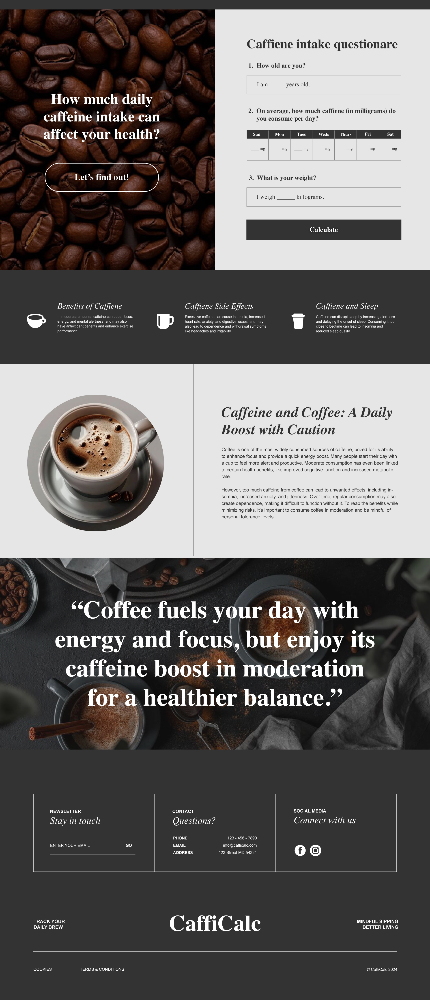

# CaffiCalc

A single-page caffeine intake calculator: enter your age, weight and a week of daily caffeine amounts, and it tells you whether you are within commonly cited limits for your age group and body weight.

Live demo: https://aldonvacriates.github.io/CaffiCal/

Bootcamp group project built in September 2024 with Helona Mekuria and Trish Ho. This repository is my copy of the team project, whose history started in [HelonaNoab/CaffiCalc](https://github.com/HelonaNoab/CaffiCalc).



*Design mockup used for the page layout. The live page also has a Bootstrap navbar.*

## Features

- Questionnaire for age, weight (kg) and caffeine in mg for each day of the week (Sunday to Saturday).
- Age-based daily limits: no caffeine recommended under 12, 100 mg/day for ages 12-17, 400 mg/day for adults (reduced by 10% for women over 18).
- Compares the weekly total against seven times the daily limit.
- For adults, also checks the average daily intake against a 3-6 mg per kg of body weight range.
- Saves the last submission to `localStorage` and re-runs the calculation with a "Welcome back" message on the next visit.
- Static informational sections on caffeine benefits, side effects and sleep.

Results are shown in browser `alert()` dialogs, and name and gender are asked for with `prompt()`. This is a learning project, not medical advice.

## Tech stack

HTML, CSS, vanilla JavaScript, Bootstrap 5.3.3 (CDN), `localStorage`, GitHub Pages.

## How it works

- `assets/js/script.js` holds all the logic. `calculateCaffeine()` reads the form fields, stores the seven daily values in an array, saves them, and passes them to `calculateCaffeineIntake()`.
- `calculateCaffeineIntake()` picks a daily limit by age, applies the gender adjustment, sums the week with `reduce`, and builds one feedback string. Teens stop after the weekly check; adults also get the per-kg check.
- `saveToLocalStorage()` and `loadFromLocalStorage()` persist one `userData` object as JSON; a `load` listener uses it to replay the last result.

## Getting started

There is no build step, package manager, environment variable or test suite.

```bash
git clone https://github.com/Aldonvacriates/CaffiCal.git
cd CaffiCal
```

Open `index.html` in a browser, or serve the folder with any static file server (for example `python -m http.server`).

## Project structure

```
index.html            Page markup (questionnaire, info sections, footer)
assets/css/style.css  Styles; page images also live in assets/css/
assets/js/script.js   Calculation and localStorage logic
```

## What I'd improve next

- Show results on the page instead of `alert()`, and replace the `prompt()` calls with form fields.
- Validate inputs (numeric age and weight, no negative values).
- Resolve the leftover merge-conflict markers in `assets/css/style.css`, move images out of `assets/css/` into an images folder, and remove the unused screenshots at the repo root.
- Fix the navbar toggler, which uses Bootstrap 4 `data-toggle` attributes with Bootstrap 5, and remove the placeholder nav links.

## Credits

Built by Helona Mekuria ([@HelonaNoab](https://github.com/HelonaNoab)), Aldo Herrera and Trish Ho ([@trishho](https://github.com/trishho)).
